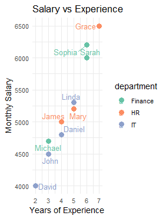

# Employee Data Analysis in R

## Project Overview

This project analyzes employee productivity, salary distribution, and project 
workload across three departments - IT, HR, and Finance - using R and ggplot2.  
The analysis uncovers patterns in compensation, efficiency, and performance 
through data transformation, aggregation, and visualization, presented as a 
fully reproducible R Markdown report.

---

## Tools & Technologies

| Tool | Purpose |
|------|---------|
| R + RStudio | Core analysis environment |
| dplyr | Data manipulation and aggregation |
| ggplot2 | Data visualization |
| ggrepel | Non-overlapping scatter plot labels |
| knitr | Table formatting in R Markdown |
| R Markdown | Reproducible HTML report |

---

## Skills Demonstrated

**Data manipulation** — `mutate()` to engineer new features (salary per project, 
productivity rate, performance rating), `group_by()` + `summarise()` for 
department-level aggregations, `reorder()` for sorted visualizations.

**Feature engineering** — Created three derived variables: `salary_per_project`, 
`productivity` (projects per hour), and `performance` classification 
(Excellent / Good / Average) using nested `ifelse()`.

**Data visualization** — Built 6 charts using ggplot2:
- Average salary by department (bar chart)
- Projects per employee (bar chart)
- Salary vs experience by department (scatter + `geom_text_repel`)
- Projects vs hours worked (scatter + `geom_text_repel`)
- Salary distribution by department (box plot)
- Employee performance distribution (bar chart)

**Reproducible reporting** — Full analysis written in R Markdown, knitting to 
a clean HTML report combining code, output, and narrative.

---

## Key Insights

- **Finance leads in compensation** — avg. $6,133/month, 22% above IT ($5,025)
- **Experience strongly predicts salary** — 6–7 year employees earn 47% more 
  than 2–3 year employees ($6,233 vs $4,250)
- **3× productivity gap exists** — Grace completes 8 projects in 175hrs; 
  David completes 3 in 150hrs, yet compensation doesn't reflect this difference
- **Performance is individual, not departmental** — Excellent, Good, and Average 
  ratings are distributed across all three departments

---
### Sample Visualization


*Scatter plot showing the relationship between years of experience and monthly salary across departments*

---
## How to Run

1. Clone this repository and open `employee_analysis.Rmd` in RStudio
2. Install required packages:

```r
install.packages(c("tidyverse", "ggrepel", "knitr"))
```

3. Click **Knit** to generate the HTML report

---

## Limitations

This analysis uses a 10-person simulated dataset. Insights are directional 
and should be validated against real-world HR data before informing decisions.

---

## Author

**Samson O.** — Aspiring Data Analyst | Spreadsheets | SQL | R | Python

